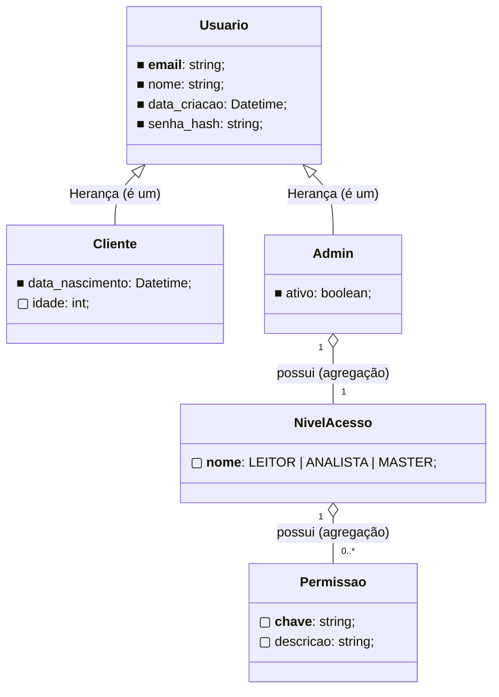

# Modelagem UML da entidade Usuário:

O Domínio de usuário é responsável por representar aqueles que terão acesso à plataforma e farão uso de suas funcionalidades, dividindo-se de forma especializada conforme as capacidades e papéis operacionais no sistema.

**Classes do Domínio:**
- **Usuario**(ABC): classe Abstrata base;
- **Cliente**(Usuario): classe concreta que herda de Usuario;
- **Admin**(Usuario): classe concreta que herda de Usuario;
- **Permissao**: classe para modelar as permissoes existentes no sistema;
- **NivelAcesso**: classe para modelar os níveis de acesso e suas respectivas permissões;

**Cliente:**
Aquele que fará uso do aplicativo, gerenciando entidades e organizando sua rotina com Agendas, Quadros, Notificações, Alertas e Lembretes.

**Admin:**
O moderador da plataforma, responsável por fazer o monitoramento do estado do sistema.
Possui diferentes níveis de acesso para garantir segurança e conformidade no sistema de moderação, além de permitir rastreamento das alterações realizadas por admins;

Para o gerenciamento dos níveis de acesso de Admin, foi utilizada uma estratégia de Permissão granular, que será validada com a utilização de três decorators.

> ■ Indica atributos com validação;   
> ▢ Indica atributos públicos;

### Implementação da validação de acesso de Admin:

Utilizará três decorators:

`@auth_token`: validará o token e extrairá o admin.email para o request.state;

`@require_permission`: realiza uma consulta otimizada no banco, cuja entrada é o admin.email e o retorno é NivelAcesso, e valida se o Admin tem permissão para executar a ação ou não;

`@log_register`: registra a ação no banco de dados, utilizando as informações obtidas nas etapas anteriores (admin.email, nivelAcesso.nome e permissao.chave).